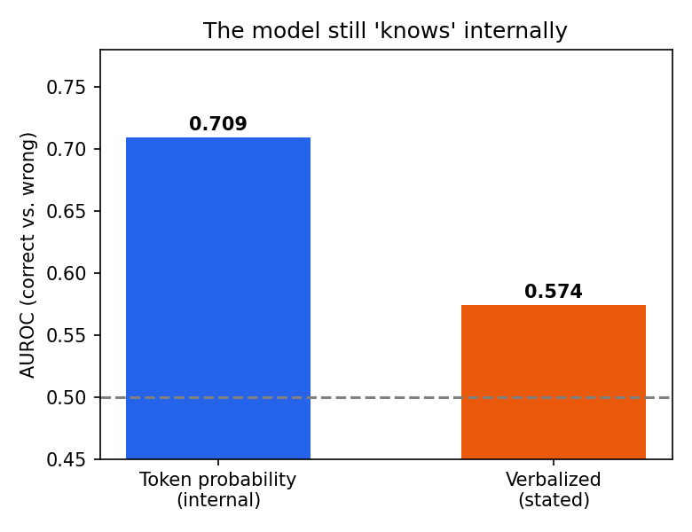
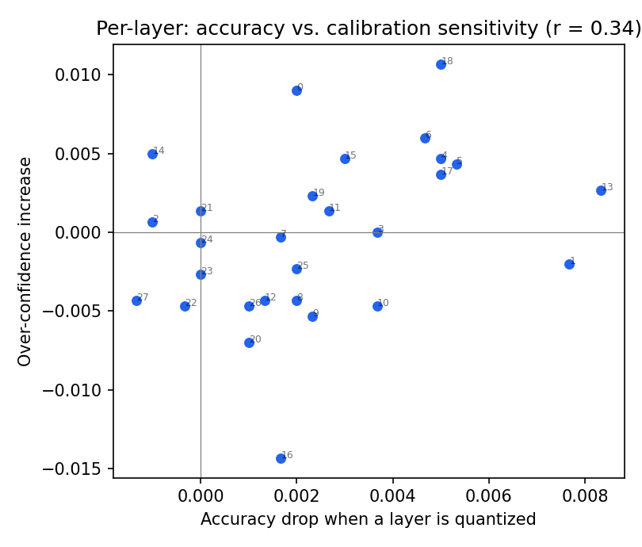
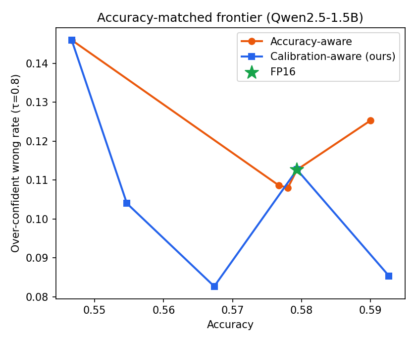

# Abstention under Compression

Small language models get more overconfident when you quantize them, but they don't actually lose the internal signal that "knows" an answer is wrong. This repo is my ongoing attempt to pin that gap down, and to test whether you can protect a model's *calibration* (not just its accuracy) when you decide how many bits each layer gets.

Independent research, started Jan 2026. Still in progress; see [Status](#status) for what's solid and what isn't.

## The short version

Everything below is on small instruction-tuned models (Qwen2.5-0.5B/1.5B/3B, Phi-3-mini), evaluated on real abstention tasks (SQuAD 2.0, AbstentionBench) plus MMLU for calibration.

**1. The model still knows; it just stops saying so.**
After compression, abstention F1 doesn't really collapse, but *overconfidence* climbs (about +109% on SQuAD, p < .001), and almost all of it is in the smallest models. At the same time the internal token-probability signal still tells right from wrong answers much better than the model's own stated confidence does (AUROC 0.709 vs. 0.574). So the monitoring stays intact; what breaks is the behavior.



**2. The layers that hurt accuracy are not the layers that hurt calibration.**
Quantize one layer at a time, measure the damage, and the layers that cost the most *accuracy* turn out to be nearly a different set from the ones that inflate *overconfidence* (correlation r ≈ 0.34, so only about 12% shared variance). The ranking of "calibration-sensitive" layers holds up across data splits (Kendall τ ≈ 0.42), so it looks like a real property rather than noise.



This is the part I care about, because every mixed-precision method I've read allocates bits by *accuracy* sensitivity. If accuracy- and calibration-sensitivity are mostly separate, those methods are spending their high-precision budget on the wrong layers for safety.

**What I'm testing:** allocate bits to protect the calibration-sensitive layers instead, and read overconfidence off an *accuracy-matched* frontier so the two strategies are compared fairly. The early sign is in the right direction but not significant yet (p ≈ 0.25), so I'm treating it as a lead, not a result.



## Repo layout

```
src/aq/            evaluation framework: data loaders, confidence signals,
                   abstention metrics, real-quant (bitsandbytes / GGUF) backends
experiments/       the mixed-precision sensitivity study (standalone scripts)
configs/           model / quant / experiment configs
results/
  mixed_precision/ the layer-sensitivity + frontier run (Qwen2.5-1.5B)
  behavioral/      abstention under real quantization (bnb 16/8/4-bit)
figures/           the plots above
tests/             unit tests for the metrics and protocol
```

Two halves share the same metrics. `src/aq` is the side that measures *behavior*: does the model abstain on genuinely unanswerable questions, under real NF4/GGUF quantization. `experiments/` is the newer *mixed-precision* side: which layers to keep in high precision.

## Quickstart

```bash
pip install -r requirements-ml.txt
pip install -e .

# check the metric + protocol stack on synthetic data (no model download)
python -m aq.cli selftest

# the mixed-precision study (needs a GPU; smoke first)
python experiments/mixed_precision_calib_fast.py --smoke
python experiments/mixed_precision_calib_fast.py \
    --model Qwen/Qwen2.5-1.5B-Instruct --n 1500 --profile-n 600 --seeds 5
```

The experiment writes `summary.json`, `profile.csv`, `frontier.csv` and the two plots into `results/`.

## Numbers so far

| metric | value |
|---|---|
| accuracy ↔ calibration sensitivity, pooled r | 0.34 |
| shared variance (r²) | ≈ 0.12 |
| calibration-layer ranking stability, Kendall τ | 0.42 |
| calib-aware vs acc-aware overconfidence, mean Δ | +0.014 |
| significance (paired permutation) | p ≈ 0.25 |

Qwen2.5-1.5B-Instruct, 4-bit group quantization (group size 128), 5 data splits, MMLU as the calibration proxy.

## Status

I try to keep the claims tight:

- Finding **1** (overconfidence rises while the internal signal is retained) and the **orthogonality** of the two sensitivities are the solid parts.
- The calibration-aware allocation **helps directionally but is not statistically significant yet**. More seeds, a finer frontier, and harsher bit-widths are the obvious next moves.
- The mixed-precision study currently uses *simulated* group quantization for per-layer control, with MMLU overconfidence as a calibration proxy. The headline result still needs reproducing under real NF4/GPTQ on the abstention tasks themselves.

## Contact

Kuan-Yao (Marcus) Tseng · tgy1118@gmail.com
