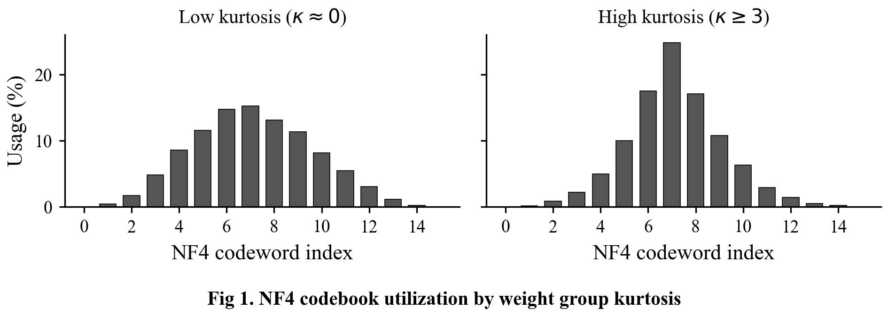
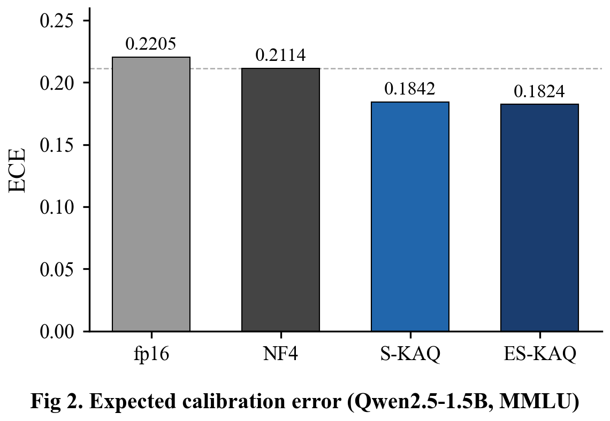
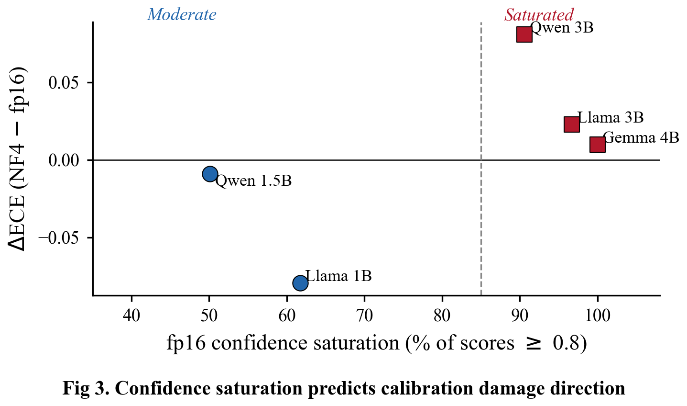

# Abstention under Compression

Quantized LLMs get more overconfident, but the internal signal that separates right from wrong answers survives compression well. This repo is my attempt to pin that gap down and fix it from the codebook side.

Independent research, started 2026. Still in progress.

## What this is about

Standard 4-bit quantization (NF4) uses a fixed codebook designed for normally distributed weights. But not all weight groups follow that shape. Groups with high excess kurtosis (heavy tails, sharp peak) get quantized poorly because NF4's evenly spaced bins waste resolution in the tails where these groups actually have values.

I test whether replacing NF4's fixed codebook with Lloyd-Max optimal codebooks, fitted per kurtosis bin, can reduce the calibration damage that quantization causes.

## Models tested

Nine instruction-tuned models across three architecture families:

- **Qwen 2.5**: 0.5B, 1.5B, 3B, 7B, 14B
- **Llama 3.1/3.2**: 1B, 3B, 8B
- **Others**: Gemma 3 4B, Phi-3-mini

Evaluated on MCQA-MMLU (multiple choice with unanswerable questions, 50/50 answerable split, N=1500 per seed, 5 seeds).

## Findings so far

**1. NF4 inflates overconfidence, not just perplexity.**

For small models, the biggest damage from NF4 isn't accuracy loss but calibration loss. ECE rises and confidence saturates (token probability > 0.95 on wrong answers).

**2. High-kurtosis weight groups drive quantization error.**

Groups with excess kurtosis >= 3 make up only 1-5% of all groups depending on architecture, but their per-group MSE is 2-4x higher than the rest. NF4's codebook is a poor fit for these distributions.



**3. KAQ reduces ECE on Qwen, not on Llama.**

Replacing codebooks for high-kurtosis groups with Lloyd-Max codebooks reduces ECE on all five Qwen models tested. The best variant is ES-KAQ (selective replacement on groups with kurtosis >= 3 only, with endpoint anchoring at +/-1.0).

On Llama 3.1-8B, the same approach reduces weight MSE by 9.4% but ECE stays flat. Paired analysis shows the confidence shift is tiny (mean -0.003 vs -0.014 on Qwen 7B). Llama also has fewer high-kurtosis groups to begin with (1.1% vs 2.8% for Qwen 7B at the same scale).



**4. The mechanism is confidence de-saturation.**

Per-item paired analysis shows KAQ shifts the confidence distribution downward on previously overconfident predictions. Models with higher baseline saturation (fraction of predictions with confidence > 0.95) show larger ECE improvement.



## KAQ variants

| Variant | Description |
|---|---|
| Full KAQ | Lloyd-Max codebooks for all kurtosis bins |
| S-KAQ | Lloyd-Max only for groups with kurtosis >= 3, NF4 for rest |
| ES-KAQ | S-KAQ + forced endpoints at +/-1.0 |

All use simulated group quantization (group size 128).

## Repo layout

```
src/aq/           evaluation framework
  data/           dataset loaders (MMLU, SQuAD 2.0, TriviaQA, AbstentionBench)
  eval/           metrics (ECE, Brier, AUROC), MCQA pipeline
  confidence/     confidence extraction (token probability, verbalized)
  models/         model loading, quantization backends (bitsandbytes, GGUF)
  analysis/       statistical tests and plotting
experiments/      standalone experiment scripts
  kaq_*.py        KAQ codebook fitting, evaluation, ablations
  exp*.py         controlled variable studies (bit width, group size, etc.)
configs/          model and quantization configs (YAML)
results/
  codebook/       per-model kurtosis profiles and KAQ codebook data
  behavioral/     abstention evaluation under real quantization
tests/            unit tests for metrics and protocol
```

## Setup

```bash
pip install -r requirements-ml.txt
pip install -e .

# unit tests (no GPU)
python -m pytest tests/ -v

# selftest on synthetic data
python -m aq.cli selftest
```

## Running experiments

```bash
# step 1: profile kurtosis distribution and fit codebooks
python experiments/kaq_phase1.py \
    --model Qwen/Qwen2.5-1.5B-Instruct --group-size 128

# step 2: evaluate with KAQ codebooks
python experiments/kaq_phase2.py \
    --model Qwen/Qwen2.5-1.5B-Instruct --n 1500 --seeds 5 \
    --codebook results/codebook/kaq_codebook_qwen15b.json
```

## Limitations

- KAQ results use simulated quantization, not real NF4 bit packing. Weight MSE matches real NF4 behavior, but inference latency overhead has not been measured.
- Effect sizes are small (ECE improvements of 1-3 percentage points). Some comparisons may not survive larger sample sizes or different evaluation sets.
- Cross-architecture finding (helps Qwen, not Llama) is based on limited models per family at comparable scales.
- 7B+ models were evaluated on a shared server with A100s. Local experiments ran on RTX 5060 (8GB).
- Simulated quantization only. Real NF4 codebook injection is not yet implemented.

## Earlier work

Before the codebook direction, I studied per-layer quantization sensitivity and found that accuracy-sensitive layers and calibration-sensitive layers are largely separate (r = 0.34). A calibration-aware bit allocation helps directionally but was not significant (p ~ 0.25). That work is in `experiments/mixed_precision_calib*.py` and `results/mixed_precision/`.

## Contact

Kuan-Yao (Marcus) Tseng · tgy1118@gmail.com
